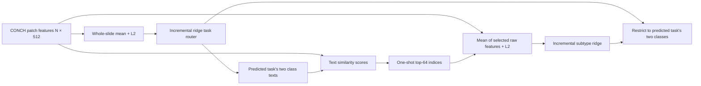

# PathSelect

**Text-guided, one-shot patch evidence selection for class-incremental whole-slide image classification.**

This is the source release for the `paper_top64_20261016` experiments. The main method is **FINAL-B / `B_TOP64_RIDGE`**: a whole-slide mean task router, one-shot selection of up to 64 patches, and an incremental subtype ridge readout. The I6 residual head (**FINAL-A**) is an ablation.

[Reproduce the experiments](docs/REPRODUCING.md) · [Method and metrics](docs/METHOD.md) · [Results](results/paper_top64/README.md) · [Data format](docs/DATA.md) · [中文說明](docs/README_zh-TW.md) · [Source and rights](NOTICE.md)



All patches are read and scored. The budget refers to **patches retained per WSI**, not training WSIs. CONCH stays frozen; FINAL-B does not use backpropagation or a replay buffer. The router and subtype ridge are supervised.

## Quick start

Linux, Python 3.11 or 3.12, CPU. The recorded experiment used PyTorch 2.11.0, float32 features and CPU float64 ridge solves, with four threads.

```bash
git clone https://github.com/Russell512/PathSelect.git
cd PathSelect
python3 -m venv .venv
source .venv/bin/activate
python -m pip install --upgrade pip
python -m pip install torch==2.11.0 --index-url https://download.pytorch.org/whl/cpu
python -m pip install -r requirements.txt
export OMP_NUM_THREADS=4 MKL_NUM_THREADS=4 OPENBLAS_NUM_THREADS=4
python -m pytest -q
python -m pathselect.demo --output outputs/demo.json
```

The demo runs both task orders and four incremental stages on synthetic features. It needs no dataset, credentials, model weights or Slurm. **Its accuracy is not a paper result.** The full benchmark runner uses Slurm and the original precomputed dataset; see [reproduction instructions](docs/REPRODUCING.md).

## Minimal API

```python
import torch
from pathselect import PathSelect

# Canonical task IDs: ESCA=0, RCC=1, BRCA=2, LUNG=3.
tasks = ["tcga_esca", "tcga_rcc", "tcga_brca", "tcga_lung"]
texts = torch.stack([
    torch.load(f"cache/text/f_txt_{task}.pt", weights_only=True)["f_txt"]
    for task in tasks
])
model = PathSelect(texts, gamma=1e-3, gamma_router=1e-3, budget=64)
# train_slides: iterable of [N,512] raw patch tensors from the CURRENT task.
# train_labels: global classes 2*task_id or 2*task_id+1; include both classes.
model.fit_task(task_id, train_slides, train_labels)
result = model.predict_slide(test_patch_features)  # no true test task supplied
print(result["predicted_class"], result["indices"])
model.save("outputs/model.pt")
```

The API exposes the main method for integration. The study scripts additionally implement residual-head training, cosine readouts, fixed random subsets, four-round comparisons, validation selection, budget/gamma sweeps, paired bootstrap statistics and real-feature timing.

## Accepted study results

Percent mean ± sample SD across 10 folds. Pairs are **original / reverse** order. A averages five seeds within each fold. `Masked` gives the true task for **both evidence selection and the final class pair**. Stage-4 predictions were checked to agree across orders for the internal methods; forgetting remains order-specific.

| Method | ACC | Masked (oracle) | Forgetting |
|---|---|---|---|
| Ridge, 8 classes, whole-slide mean | 85.66 ± 2.94 / 85.66 ± 2.94 | 92.43 ± 2.00 / 92.43 ± 2.00 | 1.01 ± 0.86 / 9.07 ± 3.21 |
| **PathSelect, one-shot top-64 (B)** | **91.99 ± 2.22 / 91.99 ± 2.22** | **94.20 ± 1.53 / 94.20 ± 1.53** | **0.87 ± 0.89 / 2.24 ± 1.84** |
| + residual head (A, five seeds) | 92.38 ± 1.99 / 92.38 ± 1.99 | 94.51 ± 1.47 / 94.51 ± 1.47 | 0.86 ± 0.46 / 2.26 ± 1.63 |

The [complete Table 1](results/paper_top64/table1_preview.md) separately identifies literature-reported rows and the independent official baseline rerun. [Table 2(b)](docs/TABLE2_AUDIT.md) is **whole-slide mean routing/readout**, not random-64. Random-64 has its own experiment ID and results.

At fixed gamma, B top-64 minus four-round selection is **−0.147 pp**, patient-cluster 95% CI **[−0.367, 0.061] pp**. Median online compute was **2.49× faster**, and median read + compute **1.49× faster**, on the same CPU node/slides. These are distinct timing scopes; neither the CI nor a nonsignificant test establishes equivalence. See [full results and limitations](results/paper_top64/README.md).

## Repository map

| Path | Purpose |
|---|---|
| `pathselect/` | Small FINAL-B API and synthetic four-stage demo |
| `selector/` | Original selection, I6 expert, pooling and incremental ridge primitives |
| `scripts/paper64_run.py` | Shared evidence, staged training/evaluation and validation-only gamma selection |
| `scripts/submit_paper64.py` | Immutable snapshots and configurable Slurm submission |
| `scripts/monitor_paper64.py` | Heartbeats, output validation and bounded infrastructure retries |
| `scripts/paper64_report.py` | Metrics, tables, sign tests and paired bootstrap intervals |
| `configs/` | Frozen experiment settings and benchmark hashes without patient IDs |
| `cache/text/` | Four unchanged class-text embedding caches; no model checkpoints |
| `results/paper_top64/` | Accepted aggregate tables, exported without numerical changes |
| `tests/` | Scientific correctness, source parity, API and export integrity checks |

## Provenance, availability and citation

This is a curated release of the accepted experiment, with portable configuration and a convenience API. It is not a claim that the release refactor was the original training source. Exact source commits, unchanged-file/function checksums and the changes are recorded in [provenance](docs/PROVENANCE.md) and [release notes](docs/RELEASE_CHANGES.md).

Raw WSIs, patch feature datasets, patient-level predictions and model checkpoints are not distributed. Dataset and model access remain subject to their providers' terms. The original splits are verified by hashes rather than regenerated. This was a development-followup experiment after earlier test exploration, not an unseen-data confirmatory trial.

For software attribution, cite this repository URL and the commit/tag used. A paper title, author list and DOI have not been invented for this release. See [NOTICE.md](NOTICE.md) for upstream attribution and the current license status; no new permissive license is asserted over upstream work.
